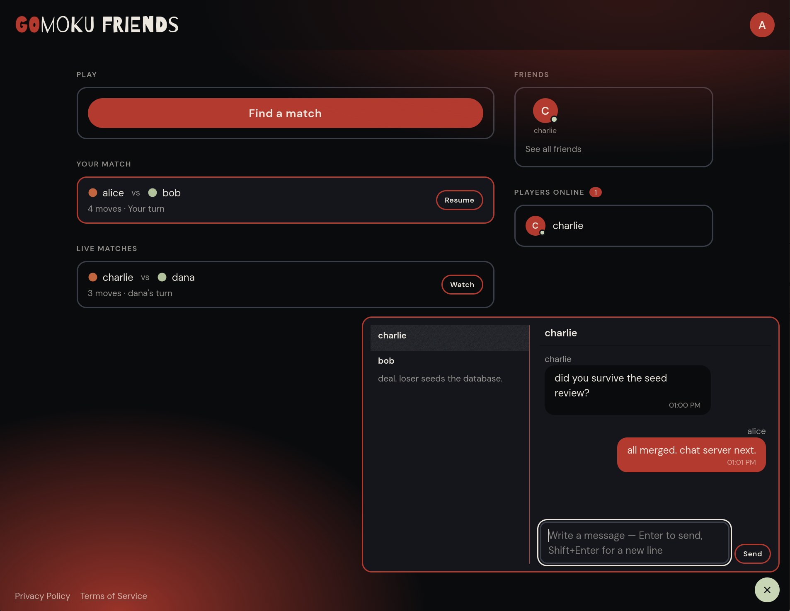
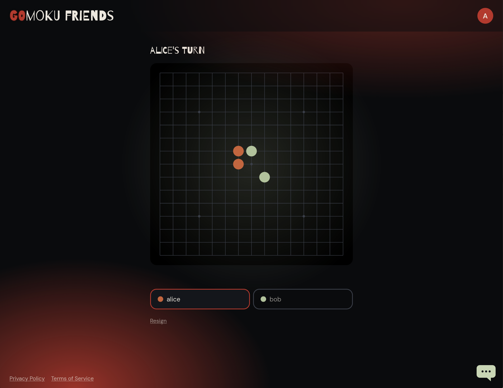
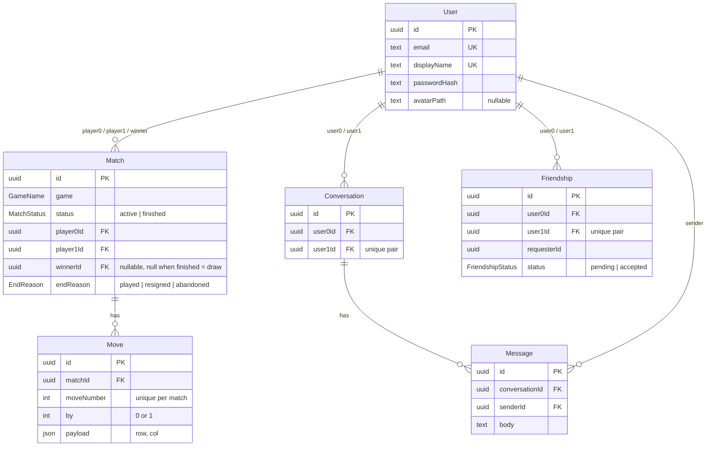

*This project has been created as part of the 42 curriculum by kziari, lprieri, rkaras, nheessel, rshaheen.*

<!--
DRAFT v3, for the whole team to review.
- Search for "TODO(team)" and fill in what applies to you.
- Check every row and paragraph with your name: is it complete and correct?
- Remaining TODOs: screenshots, individual challenges, what each person learned,
  extra references, and the AI section.
Remove all TODO comments before the evaluation.
-->

# Gomoku Friends

## Description

**Gomoku Friends** is a web application for playing Gomoku (five in a row) live against other
people. You create an account, press Play, get paired with an opponent, and play on a 15×15
board in the browser. Around the game there is a small social layer: profiles with avatars,
friends with online status, and private chat.

The goal of the project is a complete multi-user web application with a frontend, a backend
and a database. The server is the single source of truth. Clients send what they want to do,
the server checks every move with a shared game engine, stores it, and sends the result to
everyone watching.

### Key features

- **Accounts**: sign up and log in with email and password. Passwords are hashed with argon2,
  and the session is a JWT in an `httpOnly` cookie. All traffic goes over HTTPS.
- **Live Gomoku**: 15×15 board, five in a row wins, a full board is a draw. Moves appear on
  both screens without a refresh. Players can resign.
- **Matchmaking**: join a queue and get paired with the next waiting player.
- **Disconnect handling**: a player who drops out has 30 seconds to come back to the same
  board. The opponent sees a countdown. If the player does not return, the opponent wins.
- **Spectating**: the lobby lists the matches in progress, and anyone logged in can watch one live.
- **Profiles**: display name, avatar upload with a default avatar, and other players' profile pages.
- **Friends and presence**: send, accept, decline and remove friend requests, see which
  friends are online, and see a list of online players.
- **Chat**: start a private conversation from a profile and keep the message history.
- **Privacy Policy and Terms of Service** pages, linked from the footer.




## Instructions

### Prerequisites

| Tool | Version | Notes |
| --- | --- | --- |
| Docker + Docker Compose | Compose v2 (`docker compose`) | runs the three services |
| GNU Make | any recent | the single entry point |
| Node.js | 24 (see `.nvmrc`, run `nvm use`) | `make up` builds the shared game-engine package on the host first |
| A browser | latest stable | Google Chrome, or one of the other [supported browsers](#supported-browsers) |

### 1. Clone and configure

```sh
git clone git@github.com:ASprintNotAMarathon/Transcendence.git
cd Transcendence
cp .env.example .env
```

Edit `.env` and set three values. `.env` is ignored by Git, and `.env.example` is the
committed template.

| Variable | How |
| --- | --- |
| `POSTGRES_PASSWORD` | `openssl rand -hex 24` |
| `JWT_SECRET` | `openssl rand -hex 32` |
| `DATABASE_URL` | the same password, inside the connection string |

The password may only contain `A-Za-z0-9._~-`, because it is part of `DATABASE_URL`.
`make up` refuses to start while a value is still a placeholder, or when `DATABASE_URL` does
not match the `POSTGRES_*` variables.

`HTTPS_PORT` (default `8443`) and `HTTP_PORT` (default `8080`) choose where nginx is
published. They are above 1024 because rootless Docker, as on the Codam machines, cannot use
lower ports.

### 2. Start

```sh
make up
```

This one command builds the images, applies the database migrations and waits until every
service is healthy. The first run takes a few minutes. Later runs take seconds.

### 3. Check that it works

```sh
make ps
```

Three services (`nginx`, `api`, `db`), all `healthy`. Then open:

| URL | Expected |
| --- | --- |
| https://localhost:8443 | the app |
| https://localhost:8443/api/health | `{"status":"ok"}` |
| http://localhost:8080 | redirects to the HTTPS address |

The certificate is self-signed, so the browser warns the first time. Choose "Advanced" and continue.

To play from a second computer, open `https://<IP of the host machine>:8443` there. Only the
HTTPS port is reachable from the network; the API, the database and the HTTP redirect stay
on `127.0.0.1`.

### 4. Demo accounts (optional)

```sh
make seed
```

This creates four users, one finished match and two matches in progress. It is safe to run again.

| Email | Display name | Password |
| --- | --- | --- |
| alice@example.com | alice | alice-1234 |
| bob@example.com | bob | bob-12345 |
| charlie@example.com | charlie | charlie-1234 |
| dana@example.com | dana | dana-1234 |

To play a live match, log in as two of them in two browser windows (for example one normal
and one incognito) and press Play in both.

### Everyday commands

`make help` lists all of them.

| Command | Does |
| --- | --- |
| `make up` | start everything and wait until healthy |
| `make down` | stop, **keep** the database and avatars |
| `make fclean` | stop and **delete** the database and avatars |
| `make re` | `fclean`, then `up` |
| `make logs` | follow all logs |
| `make psql` | open a shell on the database |
| `make test` | run the test suites |
| `make typecheck` | typecheck every workspace |

nginx serves the built frontend, so a frontend change shows up after the next `make up`.
For hot reload while developing, run the Vite dev server by hand with
`npm run dev --workspace @transcendence/web`. The evaluation uses https://localhost:8443.

## Team Information

| Member | Login | Role(s) | Responsibilities |
| --- | --- | --- | --- |
| Kimia | kziari | Tech Lead, Developer | Defined the architecture and the technical conventions, made stack decisions, reviewed critical changes. Built the database models, authentication, the profile and avatar API, and the friends and presence API. |
| Lisandro | lprieri | Product Owner, Developer | Decided on features and priorities and validated finished work. Built the shared game engine, Gomoku, match sessions, the board, the lobby, matchmaking (backend), disconnect handling, and CI. |
| Renata | rkaras | Project Manager, Developer | Organised the meetings and planning, tracked progress and blockers. Built the Docker setup and the one-command start, the WebSocket transport and socket authentication, and the HTTPS setup with nginx. |
| Noor | nheessel | Developer | Built the frontend: app shell and routing, login and registration, profile page, friends page, online players list, matchmaking (frontend), Privacy Policy and Terms of Service. |
| Sara | rshaheen | Developer | Built chat from end to end: protocol, database tables, chat backend, starting a conversation, conversation list and message pane. Wrote the database seed script. |

## Project Management

- **Meetings**: a weekly meeting at Codam, first on Mondays and later on Fridays. In each
  meeting we went through the backlog: how far each task was, what was blocking, and which
  decisions had to be made.
- **Task organisation**: the work is split into GitHub issues, with one branch and one pull
  request per issue. Features were cut into slices so that frontend and backend could be
  built in parallel against the shared WebSocket protocol file.
- **Interfaces first**: For features that cross frontend and backend, we agreed on the
  endpoints and payloads in writing before building, so both sides could work in parallel
  and neither had to wait.
- **Code review**: every pull request uses the same template (What / Why / How to test) and is
  reviewed by a teammate before it is merged into `main`.
- **Conventions**: one vocabulary (`feat`, `fix`, `refactor`, `test`, `chore`, `docs`) for
  labels, branches and commits, described in [CONTRIBUTING.md](CONTRIBUTING.md).
- **Tools**: GitHub Issues and pull requests for tasks and reviews, GitHub Actions for CI.
  CI applies all migrations to an empty Postgres, checks that the schema and the migrations
  agree, and runs the typecheck and the tests on every pull request.
- **Communication**: Slack. Besides the channel, we kept a Slack canvas for each topic: the
  tech stack, resources, the backlog, the modules we aimed for, and the points to discuss in
  the next meeting.


## Technical Stack

| Layer | Technology |
| --- | --- |
| Frontend | React 19, TypeScript, Vite, React Router 7, Tailwind CSS 4 + daisyUI 5, socket.io-client |
| Backend | NestJS 11 (Express platform), TypeScript, Socket.IO 4, class-validator, argon2, JWT |
| Database | PostgreSQL 17, through the Prisma 7 ORM |
| Shared | `@transcendence/shared`: the game engine and the WebSocket protocol types, used by both sides |
| Infrastructure | Docker Compose, nginx (HTTPS, reverse proxy), GNU Make |
| Tooling | npm workspaces, Vitest, ESLint, Prettier, GitHub Actions |

### Why these choices

- **One language, one repository.** TypeScript on both sides in an npm-workspaces monorepo
  lets the frontend and the backend import the same package. The Gomoku rules and the
  WebSocket message types are written once in [`shared/`](shared/), so the client and the
  server cannot disagree about what a legal move or a valid message is.
- **NestJS** gives the backend a fixed structure (modules, controllers, services, guards) that
  five people can follow, with built-in validation and WebSocket gateways.
- **React + Vite** for a component-based single-page app with fast hot reload.
  **Tailwind + daisyUI** for consistent, responsive styling without custom CSS on every page.
- **PostgreSQL** because the data is relational: users, matches between two users, moves in
  a match, friendships between two users. Foreign keys and unique indexes let the database
  itself reject a duplicate email, a second friendship for the same pair, or two moves with
  the same move number. This keeps concurrent actions by different users safe.
- **Prisma** for one readable schema file, typed queries, and committed migrations that CI checks.
- **Socket.IO** for the real-time channel. It reconnects automatically and supports rooms,
  which the match, chat and presence features all use.
- **The server owns the game.** The board is never stored and never trusted from a client.
  Each accepted move is one row, and the position is rebuilt by replaying the moves through
  the engine. A player who reconnects, or a spectator who joins late, gets exactly the same board.
- **nginx** is the single HTTPS entry point. It serves the built frontend and forwards `/api`
  and the WebSocket to the backend, so the browser only ever talks to one HTTPS origin.
- **argon2 + JWT in an `httpOnly` cookie.** The password hash contains its own salt, and
  JavaScript cannot read the token. The same cookie authenticates the WebSocket connection.

## Database Schema

Six tables. The full schema with comments is
[`apps/api/prisma/schema.prisma`](apps/api/prisma/schema.prisma), and
[docs/database.md](docs/database.md) explains the conventions.



Every table follows the same rules:

- Primary keys are UUIDs, so ids cannot be guessed from a URL.
- Every table has `createdAt` and `updatedAt` as `timestamptz`.
- Pairs of users (`Conversation`, `Friendship`) store the smaller id first, with a unique
  index on the pair, so A+B and B+A are always the same row.
- Anything that can be rebuilt is stored as events: the board comes from the `Move` rows and
  is never saved as a snapshot.

## Features List

| Feature | What it does | Who |
| --- | --- | --- |
| Registration and login | Email and password, validated in the frontend and the backend, argon2 hash, JWT cookie, logout | Kimia (backend), Noor (frontend) |
| Protected routing | Pages for guests only and for logged-in users only, app shell, 404 page | Noor |
| Gomoku engine | Pure rules package: legal moves, win and draw detection, unit tested | Lisandro |
| Live matches | Moves checked by the server and sent to both players, resign, end of game | Lisandro |
| Board UI | Interactive 15×15 board with the turn and the result | Lisandro |
| Matchmaking | A queue that pairs two waiting players into a new match | Lisandro (backend), Noor (frontend) |
| Reconnection | 30-second grace period after a disconnect with a countdown for the opponent; the match resumes or is forfeited | Lisandro |
| Lobby and spectating | List of live matches, resume your own, watch others in real time | Lisandro |
| WebSocket transport | Authenticated connection, connection registry, message validation, rooms | Renata |
| Profile | View a profile, change display name, upload an avatar (type and size checked on both sides), default avatar | Kimia (backend), Noor (frontend) |
| Friends | Send, accept and decline requests, remove a friend, friends list | Kimia (backend), Noor (frontend) |
| Online status | Online dot on friends, list of online players, updated live | Kimia (backend), Noor (frontend) |
| Chat | Start a conversation from a profile, one-to-one messages, conversation list, history | Sara |
| Privacy Policy / Terms of Service | Real content, linked from the footer on every page | Noor |
| HTTPS | nginx with TLS in front of the app, HTTP redirects to HTTPS | Renata |
| One-command start | Docker Compose with health checks, Makefile, `.env` validation | Renata |
| Seed data | Demo users, matches and conversations | Sara, Lisandro |
| CI | Migration check, typecheck and tests on every pull request | Lisandro |

## Modules

| # | Category | Module | Type | Points | Who |
| --- | --- | --- | --- | --- | --- |
| 1 | Web | Use a frontend framework (React) | Minor | 1 | Noor, Lisandro, Sara |
| 2 | Web | Use a backend framework (NestJS) | Minor | 1 | Kimia, Lisandro, Renata, Sara |
| 3 | Web | Real-time features using WebSockets | Major | 2 | Renata, Lisandro, Sara, Kimia |
| 4 | Web | Allow users to interact with other users | Major | 2 | Sara, Kimia, Noor |
| 5 | Web | Use an ORM for the database (Prisma) | Minor | 1 | Kimia |
| 6 | User Management | Standard user management and authentication | Major | 2 | Kimia, Noor |
| 7 | Gaming and UX | Complete web-based game (Gomoku) | Major | 2 | Lisandro |
| 8 | Gaming and UX | Remote players | Major | 2 | Lisandro, Renata |
| 9 | Gaming and UX | Spectator mode | Minor | 1 | Lisandro |
| 10 | Accessibility and i18n | Support for additional browsers | Minor | 1 | TODO(team) |
| 11 | Web | Custom-made design system | Minor | 1 | Noor |
| | | **Total** | 5 Major, 6 Minor | **16** | |

Points: 5 Major × 2 = 10, plus 6 Minor × 1 = 6, **16 points in total**.

### Why each module, and how it is implemented

1. **Frontend framework (Minor).** React 19 with React Router builds the single-page app.
   Components are shared between pages (avatar, cards, buttons, loading, empty and error states).
2. **Backend framework (Minor).** NestJS 11 splits the API into modules (`auth`, `users`,
   `friends`, `presence`, `match`, `chat`, `ws`), each with its own controller or socket
   handlers, service and tests. A team of five needs this kind of fixed structure.
3. **WebSockets (Major).** A board game is only playable if moves arrive at once. One
   Socket.IO connection per browser tab carries match, matchmaking, lobby, chat and presence
   events. Every message uses the same typed envelope, declared once in
   [`shared/src/ws.ts`](shared/src/ws.ts) and validated when it arrives. Broadcasts go to
   rooms (one per match, one for the lobby), so each message reaches only the clients that
   need it. A connection registry tracks every socket a user has open, so a user counts as
   offline only when their last tab closes. The client shows its connection state and
   re-subscribes automatically after a reconnect.
4. **User interaction (Major).** Players should be able to find each other again after a
   game. Each user has a profile page. The friends system lets users add and remove friends
   and see their friends list. From a profile, a user can start a private chat; messages are
   delivered live and stored, so the history is still there later.
5. **ORM (Minor).** Prisma gives one schema file, typed queries and committed migrations.
   CI rebuilds the database from the migrations and fails if the result differs from the schema.
6. **Standard user management (Major).** Users can change their display name and upload an
   avatar (JPEG, PNG or WebP, up to 5 MB, checked in the frontend and the backend). Without
   an upload, a default avatar with the user's initial is shown. Users can add friends and
   see their online status, and every user has a profile page.
7. **Web-based game (Major).** Gomoku has clear rules: two players take turns on a 15×15
   board, five in a row wins, a full board is a draw, and a player can resign. The rules live
   in a pure, unit-tested engine in `shared/`. The server runs it for every move and stores
   each accepted move.
8. **Remote players (Major).** Two players on different computers play the same match in
   real time. Every move has a number, so a client that misses one notices the gap and asks
   for a fresh board. If a player disconnects, the opponent is told and a 30-second grace
   period starts. Reconnecting restores the full board from the server; otherwise the match
   ends as `abandoned` and the opponent wins.
9. **Spectator mode (Minor).** The lobby lists live matches and updates in real time. Joining
   a match as a spectator subscribes to the same broadcasts as the players, but the server
   refuses any move from a spectator.
10. **Additional browsers (Minor).** Players use different browsers, and the game should look
    and behave the same for all of them. Besides Google Chrome, the whole application is
    tested on Firefox and Safari: registration and login, matchmaking, a full
    match, reconnecting, spectating, profiles and avatars, friends, and chat. Problems found
    during testing were fixed so that the UI and the behaviour are the same in every
    supported browser. Browser-specific limitations are listed in
    [Supported browsers](#supported-browsers).
11. **Custom-made design system (Minor).** A consistent look across every page, built once
    and reused. The colour palette is defined as theme tokens in
    [`apps/web/src/index.css`](apps/web/src/index.css) (primary, secondary, base, error, and the stone and board colours of the game), and the typography uses DM Sans for text and Barrio for display headings. The reusable components live in
    [`apps/web/src/components/`](apps/web/src/components/), for example `Avatar`, `Card`,
    `PrimaryButton`, `QuietButton`, `PrimaryLink`, `FormField`, `ErrorText`,
    `SectionHeading`, `PlayerLink`, `FriendButton`, `MessageButton`, `UserMenu`, `Footer`
    and `LegalPage`, together with shared loading, empty and error states. 
    The `/design` page shows all of it together, built from the real components. Accessibility is part of the system: one focus ring everywhere, contrast checked against WCAG AA, and animation that respects
    `prefers-reduced-motion`.

## Individual Contributions

<!-- TODO(team): each person adds one or two real challenges and how they were solved. -->

**Kimia (kziari), Tech Lead and Developer**
- Technical direction: architecture, conventions, stack decisions, review of critical changes.
- User model and Prisma service. Authentication: register, login, logout, `me`, argon2
  hashing, JWT cookie, auth guard.
- Profile and avatar endpoints, friends API and presence events, matchmaking tests.
- *Challenges:* Working with the database, and making decisions for auth while the
  frontend was already waiting for them.

  ***Reason:*** I had not worked with a database like this before, and almost every table
  points to `User`, so the relations had to be right before others could build on them.
  For auth, the frontend and backend started at the same time, so Noor needed to know how
  the API would answer before I had written it, and some questions had no obvious answer.

  ***Solution:*** I wrote down the rules every table follows in
  [docs/database.md](docs/database.md). For auth, I wrote a contract with each open
  question and its options, looked into which one fit our project, and we decided together.

**Lisandro (lprieri), Product Owner and Developer**
- Product decisions: features, priorities and validating finished work.
- Shared game-engine package and the Gomoku engine, API scaffold, CI workflow, contribution
  guidelines.
- Match sessions over WebSockets, the board, end of game and resignation, the lobby,
  matchmaking (backend), disconnect and reconnection handling.
- *Challenges:* TODO.

**Renata (rkaras), Project Manager and Developer**
- Project management: meetings, planning, progress tracking and blockers.
- Docker Compose with Postgres, the one-command `make up`, the web app scaffold.
- WebSocket gateway, connection registry, message validation, cookie-based socket
  authentication, client socket module.
- HTTPS and the nginx reverse proxy.
- *Challenges:* Working with frameworks, which I still find hard. In C I call every
  function myself, but in NestJS and React the framework calls my code. What helped was
  following one socket message from the browser to the handler and back, and building on
  that in small steps.

**Noor (nheessel), Developer**
- App shell and routing, login and registration screens, connecting the socket to auth.
- Profile page with avatar upload, friends page, list of online players, matchmaking
  (frontend), Privacy Policy, Terms of Service and footer.
- The design system: colour palette, type scale, icon set, reusable components, the
  `/design` page, and the accessibility pass (focus ring, contrast, reduced motion).
- *Challenges:* A lot of newness in this project! New language, new framework, working in a group of five on one codebase. Where do you start, and how do you keep an overview while you are still learning the tools? That showed in the frontend.The app worked, but it did not look like one app: nine text sizes, three ways of going back, and buttons that each wrote their own classes.

  ***Reason:*** The styling lived in the pages instead of shared components. We started building screens before we had decided what a button, a heading or a form field should look like.

  ***Solution:*** I moved the decisions into one place: theme tokens in `index.css`, a
  type scale of six levels, an `Icon` and a `BackLink` component, and one button component
  the others build on. In a future project I would set up that foundation for an application first. Make sketches etc. before writing the first screen, instead of cleaning up afterwards.

**Sara (rshaheen), Developer**
- Chat from end to end: WebSocket events (`chat.send`, `chat.start`, …), relevant payload types, conversation and message tables, chat module, starting a conversation, history paging, conversation list, message pane, composer, unread badges and empty states.
- Database seed script.
- *Challenges:* Clicking Message for another user didn't update the chat popup if it was already open.

  ***Reason:*** The popup was already mounted and kept its existing state.

  ***Solution:*** Added a `startKey` counter in `ChatPopup.tsx` that increments on every Message press and is used as the chat window's React key. When the key changes, React remounts the chat window with the newly selected conversation and resets its state.

## WebSocket protocol

Every message either side may send over the socket is declared once in
[`shared/src/ws.ts`](shared/src/ws.ts), and both the API and the web app import it. Every
message has the same frame, `{ type, cid?, payload }`, where `cid` is a correlation id that
the server repeats on a direct reply. Errors are events with machine-readable codes.

| Namespace | Client to server | Server to client |
| --- | --- | --- |
| `match.*` | `join`, `leave`, `move`, `resign` | `state`, `moved`, `ended`, `disconnected`, `reconnected`, `rejected` |
| `queue.*` | `join`, `leave` | `matched`, `rejected` |
| `lobby.*` | `join`, `leave` | `joined`, `started`, `moved`, `ended` |
| `chat.*` | `start`, `send`, `history`, `conversations` | `started`, `message`, `history_result`, `conversations_result`, `rejected` |
| `presence.*` | `list` | `state`, `online`, `offline` |
| `friends.*` | | `changed` |
| `transport.*` | | `error` |

## Supported browsers

| Browser | Version | Status |
| --- | --- | --- |
| Google Chrome | latest stable | fully supported |
| Mozilla Firefox | latest stable | fully supported |
| Apple Safari | latest stable | fully supported |

### Browser-specific limitations

<!-- TODO(team): check each point in Chrome, Firefox and Safari before the evaluation,
     and add anything else you noticed while testing. -->

- **Minimum versions.** The styling uses Tailwind CSS 4 and modern CSS such as
  `color-mix()`, so older browsers are not supported. The minimum versions are
  Chrome 111, Firefox 128 and Safari 16.4. Older versions may show wrong colours or a
  broken layout.
- **Self-signed certificate warning.** Each browser shows the warning differently, and it
  has to be accepted once per browser (and once per computer when playing from a second
  machine):
  - Chrome: "Your connection is not private" → **Advanced** → **Proceed to localhost (unsafe)**.
  - Firefox: "Warning: Potential Security Risk Ahead" → **Advanced…** → **Accept the Risk and Continue**.
  - Safari: "This Connection Is Not Private" → **Show Details** → **visit this website** →
    **Visit Website**.
- **Time format in chat.** Message times use the browser's language and region settings,
  so the same message can show as `14:05` in one browser and `2:05 PM` in another.
- **Fonts.** DM Sans and Barrio are loaded from Google Fonts. Without an internet
  connection, each browser falls back to its own system font, so text looks slightly
  different between browsers and operating systems.

## Known limitations

- Only Gomoku can be played. The schema already reserves a second game name (Reversi), but
  it has no engine.
- Spectators cannot chat inside a match (optional part of the spectator module).
- The HTTPS certificate is self-signed, so the browser shows a warning on the first visit.

## Resources

### References

- [NestJS documentation](https://docs.nestjs.com/)
- [React documentation](https://react.dev/)
- [React Router documentation](https://reactrouter.com/)
- [Prisma documentation](https://www.prisma.io/docs)
- [PostgreSQL documentation](https://www.postgresql.org/docs/)
- [Socket.IO documentation](https://socket.io/docs/v4/)
- [Tailwind CSS](https://tailwindcss.com/docs) and [daisyUI](https://daisyui.com/)
- [Docker Compose documentation](https://docs.docker.com/compose/)
- [nginx documentation](https://nginx.org/en/docs/)
- [GitHub Actions documentation](https://docs.github.com/en/actions)
- [Vitest documentation](https://vitest.dev/)
- [OWASP Password Storage Cheat Sheet](https://cheatsheetseries.owasp.org/cheatsheets/Password_Storage_Cheat_Sheet.html)
- [Gomoku rules (Wikipedia)](https://en.wikipedia.org/wiki/Gomoku)
- [WCAG 2.1: Contrast (Minimum)](https://www.w3.org/WAI/WCAG21/Understanding/contrast-minimum.html)
- [WebAIM contrast checker](https://webaim.org/resources/contrastchecker/)
- [MDN: `:focus-visible`](https://developer.mozilla.org/en-US/docs/Web/CSS/:focus-visible)
- [MDN: `Set-Cookie`](https://developer.mozilla.org/en-US/docs/Web/HTTP/Headers/Set-Cookie)
- [MDN: `FormData`](https://developer.mozilla.org/en-US/docs/Web/API/FormData)
- [Heroicons](https://heroicons.com/)
- [Google Fonts](https://fonts.google.com/)
- [Vite documentation](https://vite.dev/guide/)
- [Conventional Commits](https://www.conventionalcommits.org/)
- TODO(team): tutorials or articles you actually used.

### How AI was used

AI tools were part of our everyday workflow, as they are in most software teams today.
Most of the stack (TypeScript, NestJS, React, Prisma, Socket.IO, GitHub Actions) was new to
us and the timeline was tight, so we treated AI as an assistant that helped us learn faster
and move faster, while the team stayed responsible for every decision and every line merged.

What we used it for:

- **Learning**: getting comfortable with TypeScript and the frameworks, and explaining
  concepts we had not met before (WebSockets, ORMs and migrations, JWT cookies, CI).
- **Planning**: breaking the project down into tasks and estimating how long they would take.
- **Decisions**: comparing options and their trade-offs before we chose one together in a meeting.
- **CI**: learning GitHub Actions and setting up the workflow.
- **Implementation**: as a pair-programming assistant across the codebase, for example to
  suggest a first version of a component, endpoint or test, which we then adapted to our
  conventions, reviewed and integrated.
- **Documentation**: drafting documentation.
- **Reading unfamiliar code**: understanding a teammate's module well enough to review it,
  or to connect our two halves of a feature.
- **Design exploration**: asking for several options and sketches for a visual choice
  before deciding, instead of implementing the first idea.
- **Debugging**: reading error messages and logs, and narrowing down where a problem
  actually came from, for example a failed request that turned out to be answered by nginx
  and not by the API.
- **Reading unfamiliar code**: understanding a teammate's module well enough to review it,
  or to connect our two halves of a feature.

<!-- TODO(team): is anything missing from this list, or used in a way not described here
     (debugging, code review, writing tests, ...)? Add it so the list is complete. -->

How we stayed in control of the result:

- **The team designed the system.** The architecture, the shared protocol, the database
  schema, the conventions and the priorities were decided by us in our weekly meetings.
  AI suggestions had to fit into that design, not the other way around.
- **Nothing was merged unseen.** Every change went through a pull request and was reviewed
  by a teammate, who had to understand it well enough to approve it. Changes that did not fit
  our conventions were sent back.
- **Every change was verified.** Features were tested by hand, and CI runs the typecheck,
  the test suites and the database migration checks on every pull request.
- **We stayed critical.** AI is good at collecting and explaining what already exists, not
  at deciding what this project should be. Those choices stayed ours.

<!-- TODO(team): read the points above and check that they are true for you. Change or remove
     anything that does not match how you worked, and add your own practice if you had one
     (e.g. rewriting suggestions by hand, asking AI to explain code before using it). -->

### What we learned

Beyond the features themselves, this project gave us experience in how a real software
team works:

- **Technical**: building a full-stack TypeScript application from scratch; designing a
  typed real-time protocol shared by client and server; keeping a server-authoritative game
  consistent across reconnects and spectators; working with a relational database, from
  designing tables and relations to using constraints that keep data correct when users act
  at the same time; evolving the schema safely with migrations that are versioned in Git and
  checked in CI; and securing authentication with hashed passwords and `httpOnly` cookies.
- **Engineering practice**: working in a monorepo with five people, a shared branching and
  commit convention, pull request reviews, and continuous integration as a safety net.
- **Teamwork**: splitting work so people could build in parallel, communicating blockers
  early, making decisions together and documenting them, and working in clear roles
  (Product Owner, Project Manager, Tech Lead).
- **Working with AI**: using AI tools productively while keeping ownership of design,
  quality and correctness, a skill we expect to need in our future jobs.

<!-- TODO(team): add what you personally learned, technical or not. One line each is enough. -->
- **Kimia:** A new language and a new framework, and working with a database for real.
  Working in a team with a clear setup (GitHub Issues, branches, reviews and Actions), and
  how to talk about a decision with the team instead of just making it.
- **Lisandro:** TODO
- **Renata:** Working the agile way (issues, a branch per issue, reviews, nobody touches `main`), which my internship at QPS uses too, and a first start with frameworks.
- **Noor:** Working in one codebase with a bigger group! Issues, branches, reviews, nothing straight to main. Learning React, TypeScript and Tailwind from scratch. And how to work with a design system.
- **Sara:** Using PR and Issues in Github for work organization, Frontend-Backend coordination, React, typescript

## More documentation

- [CONTRIBUTING.md](CONTRIBUTING.md): branch, commit and database migration rules
- [docs/database.md](docs/database.md): the database from scratch
- [docs/code-notes.md](docs/code-notes.md): the reasoning behind specific pieces of code
